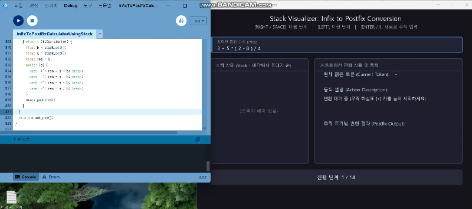
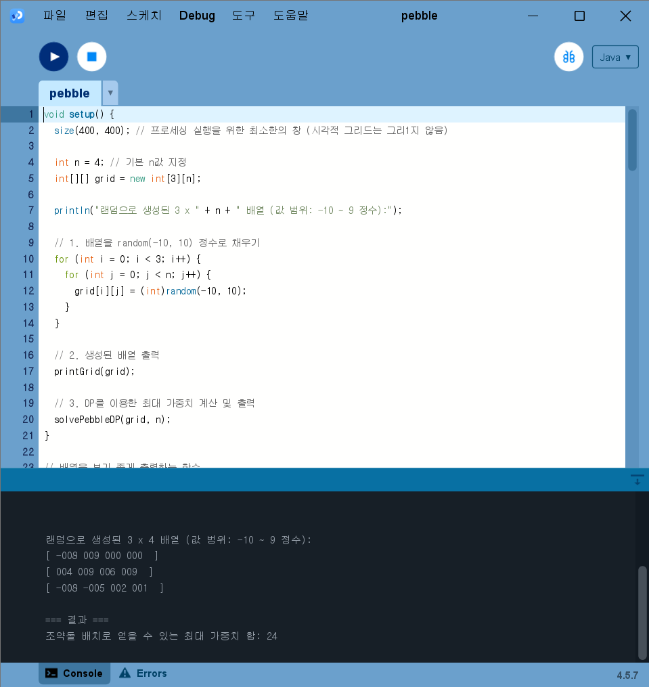
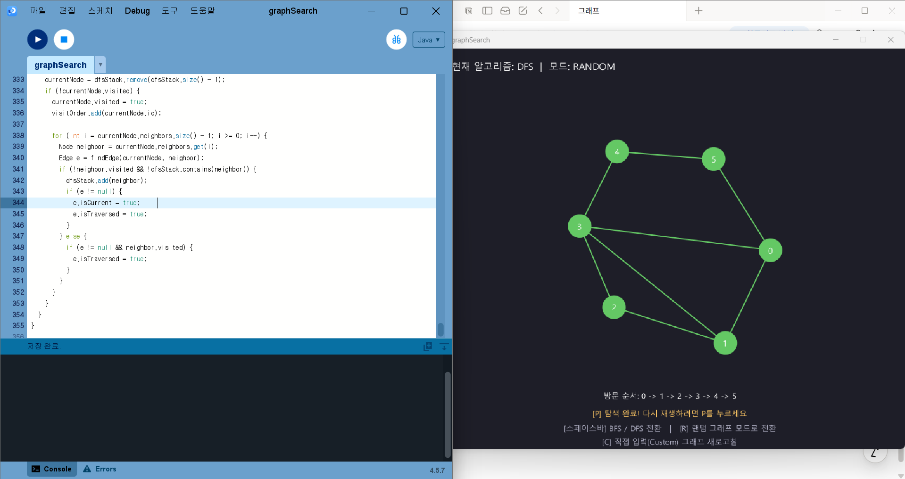
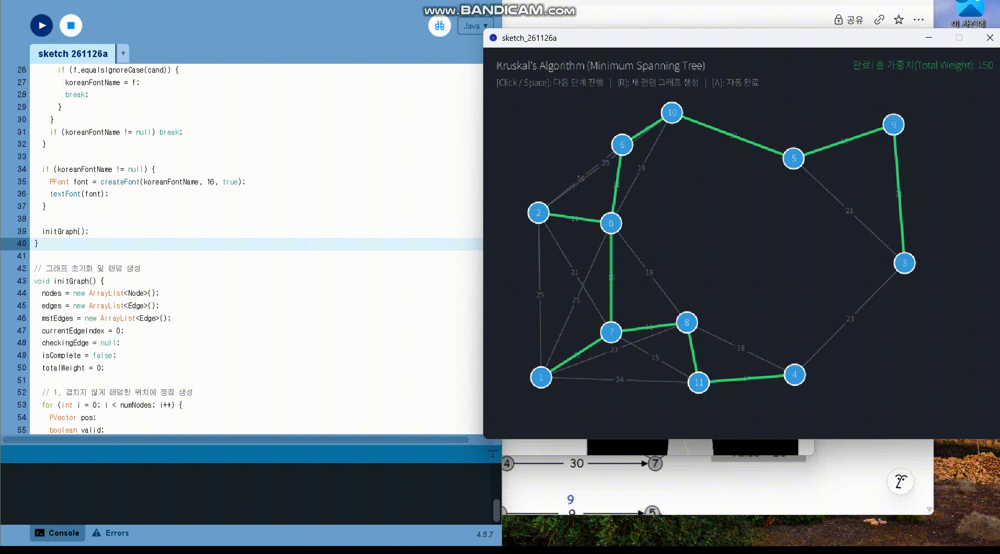

# Algorithm2026

## Homework 4

[infixToPostfixCalculatorUsingStack](homework/infixToPostfixCalculatorUsingStack.pde)

## Homework 5

[Pebble](homework/pebble.pde)

## Homework 6

[BFS and DFS for a graph](homework/graphSearch.pde)

## Homework 7

[Kruskal's Algorithm](homework/kruskal'sAlgorithm.pde)

